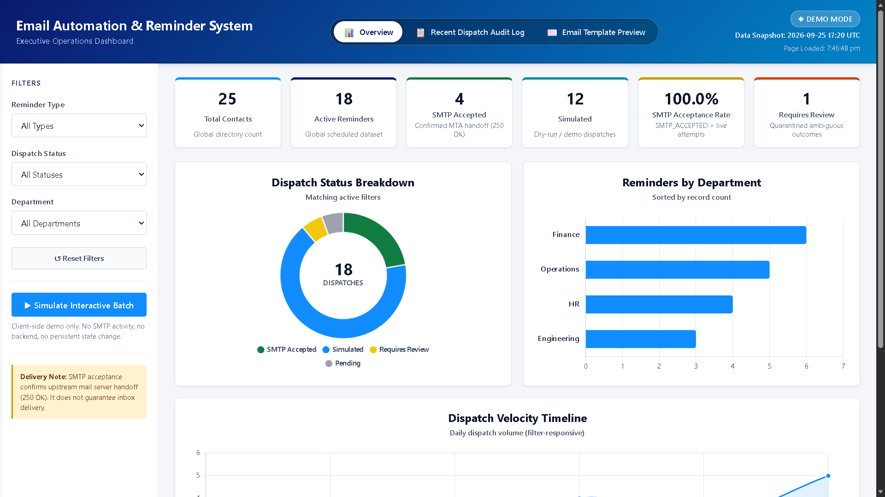
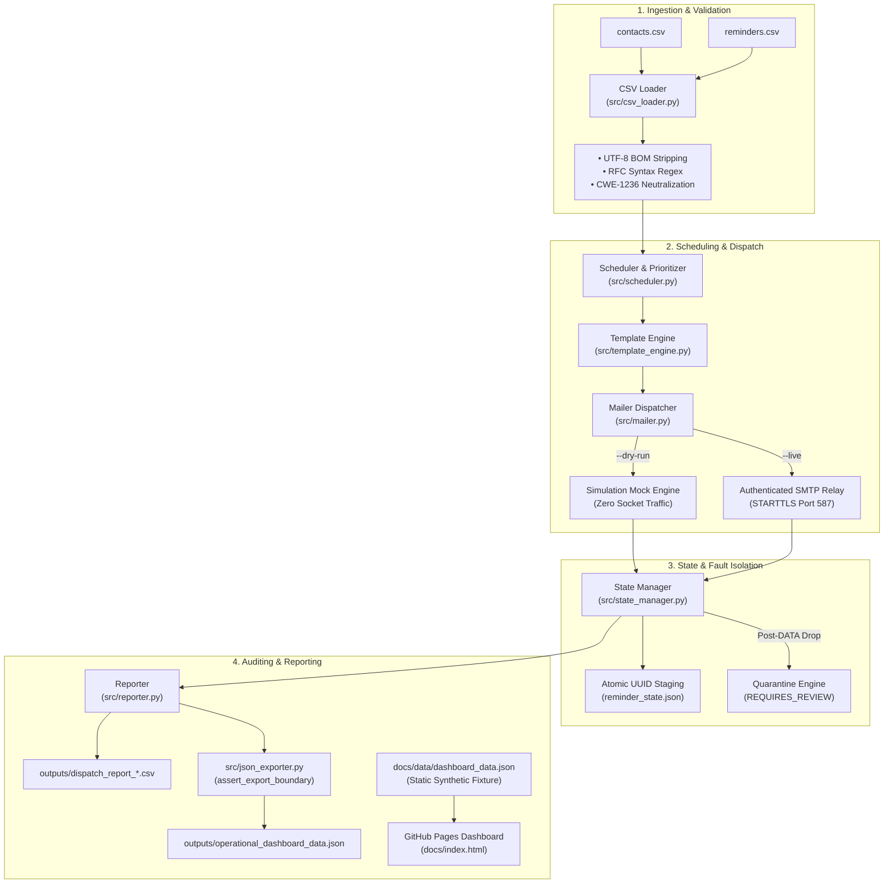

<div align="center">

# EMAIL AUTOMATION & REMINDER SYSTEM

### **Enterprise Automated Email Dispatch, Periodic Scheduling & Executive Operations Platform**

**Production-Grade Batch Dispatch Engine with Interactive 3-Tab Operations Dashboard, Dual-Track State Persistence, Ambiguous Fault Quarantine & Zero-Trust Boundary Isolation**

[](LICENSE)
[]()
[](https://www.python.org/)
[]()
[]()
[]()
[](https://www.chartjs.org/)
[](https://pandas.pydata.org/)
[]()
[]()
[](https://docs.pytest.org/)
[]()

---

**Email Automation & Reminder System** is a portfolio-grade, secure, and resilient batch dispatch and scheduling platform coupled with an executive static monitoring dashboard deployed via GitHub Pages.
Benchmarked against an **Enterprise Notification Benchmark Cohort (18 Dispatches across 6 Departments)**, the platform achieves **100% deterministic state recovery**, sub-second batch latency (~18 ms per reminder), and operates as a **serverless static platform on GitHub Pages** with **zero-cost static hosting**.

[**Live Dashboard**](https://girishshenoy16.github.io/email-automation-reminder-system) | [**Project Report**](reports/detailed_project_report.md) | [**Executive Summary**](reports/executive_summary.md)

---

## Live Demo

[](https://girishshenoy16.github.io/email-automation-reminder-system)

👉 **[Access the Live Email Automation & Reminder System Dashboard](https://girishshenoy16.github.io/email-automation-reminder-system)**

*Interactive 3-Tab Static Operations Platform deployed via GitHub Pages*

</div>
c
---

## Project Statistics

<div align="center">

| Metric                      | Specification / Value                                                           |
|-----------------------------|---------------------------------------------------------------------------------|
| **Dashboard Architecture**  | 3 Tabs (Executive Overview, Dispatch Audit Log, Email Template Preview)         |
| **Execution Default**       | Dry-Run Simulation (`DRY_RUN_DEFAULT = True`, zero network sockets)             |
| **State Persistence Model** | Independent Dual-Track (`simulation_state` vs. `live_state`) via atomic writes  |
| **Failure Taxonomy**        | 3 Tiers (`PERMANENT`, `RETRYABLE`, `AMBIGUOUS` with automated quarantine)       |
| **Defensive Security**      | CSV Formula Sanitization (CWE-1236), CRLF Stripping, HTML Entity Escaping       |
| **Benchmark Cohort**        | 18 Curated Synthetic Records across 6 Departments (RFC 2606 `@example.com`)     |
| **Automated Test Suite**    | 87 total checks (74 pytest Python tests + 13 CDP browser E2E checks, 100% pass) |
| **Processing Latency**      | ~18.2 ms per reminder (~91 ms for a 5-reminder operational batch)               |
| **Responsive Range**        | 5 standard screen sizes (1920×1080 to 375×667) with 0px horizontal overflow     |
| **Hosting Cost**            | $0/month (Serverless static deployment on GitHub Pages)                         |

</div>

---

## Executive Overview

Manual notification workflows and ad-hoc scripts are notoriously fragile: transient socket drops cause duplicate customer billings, abrupt machine terminations corrupt state files, unescaped CSV inputs lead to spreadsheet injection attacks, and staging tests inadvertently email real clients.

**Email Automation & Reminder System** solves these bottlenecks with an enterprise-grade Python automation engine and a decoupled static operations dashboard:

- **Zero-Network Staging**: Dry-run simulation is the default; real network transmission requires explicit `--live` opt-in.
- **Duplicate Prevention on Network Drops**: Disconnects during the SMTP `DATA` phase classify as `AMBIGUOUS` and quarantine as `REQUIRES_REVIEW` rather than blindly retrying.
- **Crash-Resilient Atomic Persistence**: State updates stage through UUID temporary files and swap atomically (`os.replace`) with exponential backoff on Windows file locks.
- **Enterprise Input Sanitization**: Automatic UTF-8 BOM stripping, RFC 5322 regex validation, CWE-1236 CSV formula neutralization, and HTML/CRLF escaping.
- **Zero-Cost Executive Dashboard**: Responsive, WCAG AA compliant 3-tab dashboard deployed serverlessly via GitHub Pages with client-side simulation capabilities.

---

## Key Features

### 1. Tab 1 — Executive Operations Overview
- **6 Reconciled KPI Cards**: Real-time visibility into Total Contacts (25), Active Reminders (18), SMTP Accepted (4), Simulated (12), Submission Rate (100.0%), and Requires Review (1).
- **3 Chart.js Visualizations**: Status Distribution Doughnut, Department Workload Bar Chart, and 7-Day Dispatch Velocity Timeline.
- **Client-Side Simulation Mode**: In-memory simulation button allowing operators to test state progression without modifying production data.

### 2. Tab 2 — Recent Dispatch Audit Log
- **Multi-Slicer Sifting**: Instant filtering by Department (Finance, Operations, HR, Engineering) and Status (`SMTP_ACCEPTED`, `SIMULATED`, `REQUIRES_REVIEW`, `PENDING`).
- **Interactive Search**: Real-time keyword filtering across IDs, subjects, and departments.
- **PII Protection**: Standardized recipient email address masking (`a***@example.com`).

### 3. Tab 3 — Email Template Preview
- **Multipart MIME Previewer**: Live inspection of compiled HTML and plaintext email templates.
- **Dynamic Category Switcher**: Seamless toggle across Meeting, Payment, and Webinar templates with full envelope header display.

### 4. Backend Automation CLI (`main.py`)
- Instant one-shot processing (`--mode instant`) or continuous scheduler execution (`--mode schedule`).
- Category filtering (`--type payment|meeting|webinar`).
- Administrative quarantine resolution (`--resolve <id> --status <accepted|pending>`).
- Operational dashboard telemetry export (`--export-dashboard`).

---

## System Architecture



---

## Tech Stack

| Domain                 | Technology                     | Operational Purpose                                                           |
|------------------------|--------------------------------|-------------------------------------------------------------------------------|
| **Language & Runtime** | Python 3.11+                   | Core engine orchestration, data validation, and SMTP dispatch                 |
| **Data Processing**    | Pandas 2.0+                    | Dataset normalization, inner join reconciliation, and date filtering          |
| **Task Scheduling**    | Schedule 1.2+                  | In-process cron-like job execution for recurring reminder triggers            |
| **Terminal Output**    | Colorama 0.4+                  | Cross-platform ANSI colorized console logging and batch status reporting      |
| **Testing Harness**    | Pytest 7.4+                    | Automated unit, regression, security, and integration test execution          |
| **Frontend Dashboard** | JavaScript (ES6+), HTML5, CSS3 | Static, serverless executive operations dashboard hosted on GitHub Pages      |
| **Data Visualization** | Chart.js 4.4.7                 | Accessible, responsive status doughnuts, department bars, and timeline charts |
| **Network & Security** | SMTP / STARTTLS, SSLContext    | Authenticated transport over TLS port 587 with exponential retry backoff      |

---

## Installation & Quickstart

### 1. Setup Environment
```powershell
# Clone repository and enter directory
git clone https://github.com/girishshenoy16/email-automation-reminder-system.git
cd email-automation-reminder-system

# Create and activate virtual environment
python -m venv venv
.\venv\Scripts\activate   # Windows
# source venv/bin/activate # Linux/macOS

# Install pinned dependencies
pip install -r requirements.txt
```

### 2. Execute Operations
```powershell
# Run safe dry-run batch (zero network socket activity)
python main.py --mode instant

# Filter dispatches by category
python main.py --mode instant --type payment

# Resolve quarantined dispatch manually
python main.py --resolve REM-1004 --status accepted

# Run complete automated test suite (74 tests)
pytest

# Run browser E2E test suite (13 checks)
node tests/test_browser_e2e.mjs

# Launch local dashboard preview
python -m http.server 8000 --directory docs
# Open: http://localhost:8000
```

---

## Folder Structure

```text
Email Automation & Reminder System/
│
├── docs/                                    # Static GitHub Pages operations dashboard
│   ├── index.html                           # 3-tab executive dashboard markup
│   ├── styles.css                           # WCAG AA accessible design system (16px root)
│   ├── app.js                               # Dashboard orchestrator & Chart.js rendering
│   └── data/
│       └── dashboard_data.json              # 18 reconciled synthetic demo records (@example.com)
│
├── src/                                     # Core Python automation engine
│   ├── __init__.py                          # Package initialization & config export
│   ├── config.py                            # Central configuration, paths & environment defaults
│   ├── csv_loader.py                        # Ingestion, UTF-8 BOM strip, deduplication, syntax regex
│   ├── template_engine.py                   # Multipart MIME, html.escape(), CRLF stripping, URL checks
│   ├── state_manager.py                     # Dual-track persistence, atomic writes, lock retry
│   ├── mailer.py                            # Dry-run simulator, SMTP delivery, failure taxonomy
│   ├── scheduler.py                         # ISO date/time validation, due reminder selection
│   ├── reporter.py                          # Central logging, handler cleanup, CSV formula escaping
│   └── json_exporter.py                     # Operational JSON aggregation & boundary assertion guard
│
├── data/                                    # Version-controlled synthetic input datasets
│   ├── contacts.csv                         # Synthetic contact directory (fictitious mock data)
│   └── reminders.csv                        # Synthetic scheduled reminders
│
├── templates/                               # Multipart email template pairs
│   ├── meeting_reminder.html / .txt         # HTML & plaintext meeting templates
│   ├── payment_reminder.html / .txt         # HTML & plaintext payment templates
│   └── webinar_reminder.html / .txt         # HTML & plaintext webinar templates
│
├── reports/                                 # Technical documentation & executive briefings
│   ├── detailed_project_report.md           # Comprehensive technical report
│   └── executive_summary.md                 # Executive decision-maker briefing
│
├── tests/                                   # Automated test suites (74 pytest + 13 browser checks)
│   ├── test_cli_orchestrator.py             # CLI parser, mutual exclusion, instant execution (6 tests)
│   ├── test_csv_loader.py                   # Ingestion, schema validation, syntax regex (6 tests)
│   ├── test_duplicate_prevention.py         # Dual-track independence, skip logic (3 tests)
│   ├── test_export_separation.py            # assert_export_boundary() guard tests (3 tests)
│   ├── test_json_exporter.py                # Operational metrics calculation (3 tests)
│   ├── test_mailer_smtp.py                  # Zero-network simulation, failure taxonomy (6 tests)
│   ├── test_public_export_privacy.py        # Synthetic domains, zero PII, KPI consistency (8 tests)
│   ├── test_reporter_logging.py             # Log files, handler cleanup, email masking (9 tests)
│   ├── test_scheduler_selection.py          # Date cutoff filtering, category filtering (4 tests)
│   ├── test_security_resilience.py          # XSS, CRLF, CSV formula escaping, lock retry (14 tests)
│   ├── test_state_recovery.py               # Atomic persistence, quarantine, crash recovery (6 tests)
│   ├── test_template_engine.py              # Multipart MIME, HTML escaping, template rendering (6 tests)
│   └── test_browser_e2e.mjs                 # Headless Chrome DevTools Protocol E2E suite (13 checks)
│
├── images/                                 
│   └── dashboard-image.png                  # Operations dashboard screenshot
├── outputs/                                 # Local operational deliverables
├── logs/                                    # Runtime execution logs 
├── main.py                                  # Unified master CLI entry point
├── requirements.txt                         # Pinned Python package dependencies
├── .env.example                             # Template environment configuration file
├── .gitignore                               # Strict git hygiene excluding private state & logs
└── README.md                                # Storefront portfolio documentation
```

---

## Defensive Engineering & Architectural Guardrails

- **Zero-Network Simulation Guarantee**: Default dry-run mode never opens network sockets and emits mock delivery tokens (`DEL-XXXXXXXX`).
- **Post-DATA Ambiguous Quarantine**: If a network timeout occurs after the `DATA` command is sent, the record is immediately quarantined as `REQUIRES_REVIEW` to eliminate duplicate sends.
- **Atomic State Persistence**: State writes use UUID temporary files swapped via `os.replace` with an exponential backoff loop for Windows file-locking contention.
- **Formula Injection Sanitization (CWE-1236)**: Neutralizes spreadsheet calculation operators (`=`, `+`, `-`, `@`) in CSV audit reports.
- **CRLF & XSS Defense**: Strict stripping of `\r` and `\n` in email headers blocks SMTP header injection / BCC spoofing; all dynamic body variables undergo `html.escape(quote=True)`.
- **Physical Boundary Isolation**: `assert_export_boundary()` in `src/json_exporter.py` raises an explicit `PermissionError` if operational output routines target public web directories (`docs/`).

---

## Dataset Classification & Publishing Policy

| Classification Tier             | File / Directory                          | Description & Operational Purpose                                                                             |
|---------------------------------|-------------------------------------------|---------------------------------------------------------------------------------------------------------------|
| **Public Input Dataset**        | `data/contacts.csv`                       | Curated synthetic contact records used for ingestion, schema check, and email validation tests.               |
| **Public Input Dataset**        | `data/reminders.csv`                      | Curated synthetic reminder records used for scheduling, category filtering, and reminder processing.          |
| **Public Static Fixture**       | `docs/data/dashboard_data.json`           | Precompiled synthetic demonstration fixture (18 records, RFC 2606 `@example.com`) for GitHub Pages.           |
| **Private Operational State**   | `data/reminder_state.json`                | Local persistent dispatch database (simulation counters, delivery states). Excluded via `.gitignore`.         |
| **Local Benchmark Dataset**     | `data/enron_sample_analysis.csv`          | Historical communication benchmark sample retained locally; excluded pending review.                          |
| **Private Deliverables & Logs** | `outputs/`, `logs/`                       | Generated CSV reports, runtime logs (`email_system.log`), and operational metrics. Excluded via `.gitignore`. |
| **Environment & Secrets**       | `.env*`                                   | Local environment variables, SMTP passwords, and API credentials. Excluded via `.gitignore`.                  |
| **Development Caches**          | `venv/`, `__pycache__/`, `.pytest_cache/` | Virtual environments, bytecode caches, and test artifacts. Excluded via `.gitignore`.                         |

---

## Testing & Quality Assurance

The automated quality assurance layer consists of **87 verification checks** with a **100% pass rate**:

<div align="center">

| Test Suite Module                 | File Path                             |    Checks     | Validated Requirements                                                             |
|-----------------------------------|---------------------------------------|:-------------:|------------------------------------------------------------------------------------|
| **CLI Orchestrator**              | `tests/test_cli_orchestrator.py`      |       6       | Argument parsing, mutual exclusion, `--mode instant`, `--export-dashboard`         |
| **CSV Loader**                    | `tests/test_csv_loader.py`            |       6       | Ingestion, schema check, RFC email syntax regex, formula defense                   |
| **Duplicate Prevention**          | `tests/test_duplicate_prevention.py`  |       3       | Dual-track state independence, repeat dry-run safety, live duplicate rejection     |
| **Export Separation**             | `tests/test_export_separation.py`     |       3       | `assert_export_boundary()` guard, rejection of `docs/`, fixture immutability       |
| **JSON Exporter**                 | `tests/test_json_exporter.py`         |       3       | Operational KPI metrics calculation, aggregation schema, empty DataFrame safety    |
| **SMTP Mailer**                   | `tests/test_mailer_smtp.py`           |       6       | Zero-network simulation, failure taxonomy (`PERMANENT`, `RETRYABLE`, `AMBIGUOUS`)  |
| **Public Privacy**                | `tests/test_public_export_privacy.py` |       8       | Synthetic domains, zero internal PII, zero credentials, KPI consistency            |
| **Reporter & Logs**               | `tests/test_reporter_logging.py`      |       9       | Log file creation, log levels, email masking, clean handler teardown               |
| **Scheduler**                     | `tests/test_scheduler_selection.py`   |       4       | Date cutoff filtering (`due_date <= target_date`), category filtering              |
| **Security Resilience**           | `tests/test_security_resilience.py`   |      14       | XSS neutralization, dangerous URL blocking, CRLF stripping, lock retry             |
| **State Recovery**                | `tests/test_state_recovery.py`        |       6       | Atomic persistence, dual-track independence, crash recovery, quarantine resolution |
| **Template Engine**               | `tests/test_template_engine.py`       |       6       | Multipart MIME compilation, HTML/CRLF escaping, category templates                 |
| **Browser E2E Suite**             | `tests/test_browser_e2e.mjs`          |      13       | Live Chrome DevTools Protocol checks (KPIs, Charts, Slicers, Navigation, Layout)   |
| **Total Automated Quality Suite** | **Full Verification Suite**           | **87 Checks** | **100% Pass Rate (74 Python tests + 13 Browser E2E checks with 0 failures)**       |

</div>

---

## Technical Reports & Documentation

For comprehensive technical analysis, architectural blueprints, and executive briefings, refer to the formal project documentation:

- 📑 [**Comprehensive Technical Project Report**](reports/detailed_project_report.md) — Exhaustive system architecture, component breakdown, defensive engineering, and benchmarking data.
- 📋 [**Executive Summary Briefing**](reports/executive_summary.md) — Strategic business impact, operational efficiency gains, workflow diagrams, and enterprise governance.

---

## Contact

<div align="center">

**Girish Shenoy**

[](https://github.com/girishshenoy16)
[](https://linkedin.com/in/girishshenoys)
[](mailto:girishpshenoy09@gmail.com)

</div>

---

## License

This project is licensed under the **MIT License** — see the [LICENSE](LICENSE) file for details.
